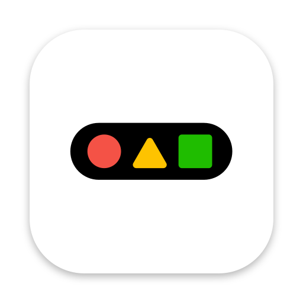

<p align="center">
  
</p>

<h1 align="center">oh-my-dock</h1>

A free, open source macOS menu bar app for switching between saved layouts of the native macOS Dock.

oh-my-dock only changes Apple's real Dock. It does not draw its own dock, replace it, or overlay anything on top of it.

- 🆓 Free and MIT licensed. No paid tier, no account, no analytics.
- 💻 Requires macOS 14 (Sonoma) or later.
- 🫥 Menu bar app. It has no Dock icon.

## ✨ Features

**🗂️ Profiles**
- Save the current Dock as a named profile. On first launch the current Dock is saved as "Default".
- Switch from the menu bar, with a per-profile global hotkey, from the editor's **Activate** button, from the CLI, a URL, or Apple Shortcuts.
- Rename, duplicate, and delete profiles.

**🎨 Visual editor**
- Your Dock is drawn inside a MacBook mockup over your own wallpaper. Pick the MacBook model and colour, or switch to a plain strip.
- Reorder tiles by drag and drop. Add apps, URLs, folders, files, and spacers.
- An inspector edits the selected tile: folder view, display and sort, labels, and whether an app launches when the profile is applied.
- The same inspector has a **Dock** tab for the profile's Dock preferences, so the mockup shows the result as you change it.

**⚙️ Dock preferences, per profile**
- Icon size, magnification, position, auto-hide and its delay and speed, recent apps, running apps only, minimize effect, running indicators, launch animation, and more.
- Live preview on your real Dock that you can revert or keep. Reset any value to the system default.
- Leave "Manage Dock preferences" off and applying the profile leaves your Dock's preferences alone.

**🛟 Safe switching**
- **Diff preview** shows what will be added, removed, or moved before anything changes.
- **App switching:** a profile can launch apps and quit running apps. Quitting always asks first, uses a graceful quit only, and Undo does not reopen apps.
- **Snapshots, undo, and history:** every change is preceded by a snapshot. Undo the last change, or restore or delete any snapshot in History.
- Every write is checked by re-reading the Dock. If a switch fails, the previous snapshot is restored.

**🤖 Automation**
- **`ohmydock` CLI:** list, show, current, apply, save, import, export, undo, snapshots, restore, status, doctor, and shell completions. Headless, with a JSON mode and fixed exit codes. Also exports a profile as a dockutil script.
- **`ohmydock://` URL scheme:** apply, save, undo, and open windows. Changes need in-app confirmation. A Settings option sets ask, allow, or don't allow.
- **Apple Shortcuts (App Intents):** apply a profile, save the current Dock, list profiles, undo.

**🖥️ App**
- Menu bar app with no Dock icon. Launch at login is optional.
- Optional daily update check against GitHub Releases.
- Homebrew cask, with the CLI and man page linked into your PATH.

## 📦 Install

### 🍺 Homebrew

```sh
brew install --cask Farzin-Firoozi/tap/oh-my-dock
```

The cask clears the quarantine attribute, so the app opens without the steps in [First launch](#-first-launch).

### 💾 Manual

1. Download `OhMyDock-<version>.zip` and its `OhMyDock-<version>.zip.sha256` file from the [GitHub Releases](https://github.com/Farzin-Firoozi/oh-my-dock/releases) page.
2. Verify the download (see [Verify the download](#-verify-the-download)).
3. Unzip the archive and move `OhMyDock.app` to `/Applications`.
4. Open the app. If macOS blocks it, follow [First launch](#-first-launch).

## 🚀 First launch

oh-my-dock is **not notarized**. The project has no Apple Developer account, so Apple cannot verify it. The first time you open a manually downloaded copy, macOS says it cannot verify the app. Use one of these:

- **Right-click the app, choose Open, then click Open.**
- **Or** run this in Terminal:

  ```sh
  xattr -dr com.apple.quarantine /Applications/OhMyDock.app
  ```

On macOS 15 and later, the right-click method may not be enough. Open System Settings, go to Privacy & Security, and click **Open Anyway** next to the blocked app. Then open the app again.

Builds made with an Apple Developer ID and notarization are planned for when the project has an Apple Developer account.

## 🔐 Verify the download

Each release publishes a SHA-256 checksum file next to the zip. In the folder with both files, run:

```sh
shasum -a 256 -c OhMyDock-<version>.zip.sha256
```

The command prints `OK` when the zip matches the published checksum.

## 🧭 Usage

1. **Start.** On first launch, oh-my-dock saves your current Dock as a profile named "Default" and creates a pinned "First launch" snapshot. Nothing else changes.
2. **Save a layout.** Arrange the Dock the way you want, then choose **Save current Dock as…** from the menu bar and name it.
3. **Edit.** Choose **Open editor…** to rearrange tiles, add items, set Dock preferences in the **Dock** tab of the inspector, or manage profiles. Click **Activate** to apply the open profile.
4. **Switch.** Click a profile in the menu bar. Choose **Review Changes…** to open the diff preview, then **Apply Changes**. Choose Cancel at any step to leave the Dock unchanged.
5. **Undo.** Choose **Undo last change** in the menu bar to return to the Dock as it was before the last switch.
6. **History.** Choose **History…** to see all snapshots, restore one, or delete one. Restoring replaces the current Dock.
7. **Hotkeys.** In Settings, under Profile hotkeys, record a shortcut for any profile.

The Dock restarts once per switch, so icons flash briefly.

## ⌨️ Command line and automation

The **`ohmydock`** CLI is bundled at `OhMyDock.app/Contents/Helpers/ohmydock` (Homebrew symlinks it into your PATH). It runs headless; the menu-bar app does not need to be open.

```sh
ohmydock --json list
ohmydock apply Work --dry-run --json
ohmydock apply Work --yes
ohmydock save "Meeting layout"
```

Full command reference, exit codes, URL scheme, Shortcuts, and safety rules for scripts and AI agents: **[docs/agents.md](docs/agents.md)**.

## 🛡️ Safety and privacy

- **Writes go through dockutil.** Dock changes are made by a bundled copy of [dockutil](https://github.com/kcrawford/dockutil) (Apache-2.0). Each write is checked by re-reading the Dock. If a switch fails, the app restores the previous snapshot.
- **Local data.** Profiles and snapshots are stored in `~/Library/Application Support/oh-my-dock`. Delete that folder to remove them.
- **Network.** The only network request is an optional update check against the GitHub Releases API. You can turn it off in Settings.

## ⚠️ Limits and known issues

- The app is not notarized. See [First launch](#-first-launch).
- Tested on the newest macOS release only. macOS 14 and 15 are not yet tested.
- Launch at login may fail to register on ad-hoc signed builds. The error is shown in Settings.
- Importing and exporting profiles is available from the CLI only, not the app's UI.
- Finder and Trash are always on the Dock and can't be managed. macOS controls them.
- Automatic switching triggers (Focus, display, Wi-Fi, schedule, frontmost app) and the community profile gallery are not built yet. CLI, URL scheme, and Shortcuts actions are documented in [docs/agents.md](docs/agents.md). Plans are in [docs/](docs/README.md).

## 🛠️ Build from source

Requirements: Xcode 27 with `xcodegen` and `shasum` available on your PATH.

```sh
make hooks      # enable the git hooks in .githooks
make dockutil   # build the bundled dockutil helper
make test       # run the test suite
make build      # build the app (Debug)
make release    # ad-hoc signed Release build, zip, and checksum in dist/
make verify-release APP=path/to/OhMyDock.app   # check a built app
```

The project is generated from `project.yml` with XcodeGen. Core logic lives in `Packages/OhMyDockCore`, and the app is in `App/`.

## 📚 Documentation

- [docs/README.md](docs/README.md): project overview and document index
- [docs/implementation-plan.md](docs/implementation-plan.md): architecture and milestones
- [docs/technical-notes.md](docs/technical-notes.md): Dock backend and platform limits
- [docs/distribution.md](docs/distribution.md): Homebrew cask and release checklist

## 📄 License

oh-my-dock is licensed under the [MIT License](LICENSE).

Third-party components and their licenses are listed in [THIRD_PARTY_NOTICES.md](THIRD_PARTY_NOTICES.md). They include dockutil (Apache-2.0) and KeyboardShortcuts (MIT).
